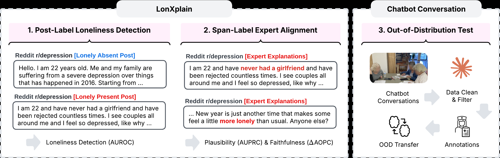
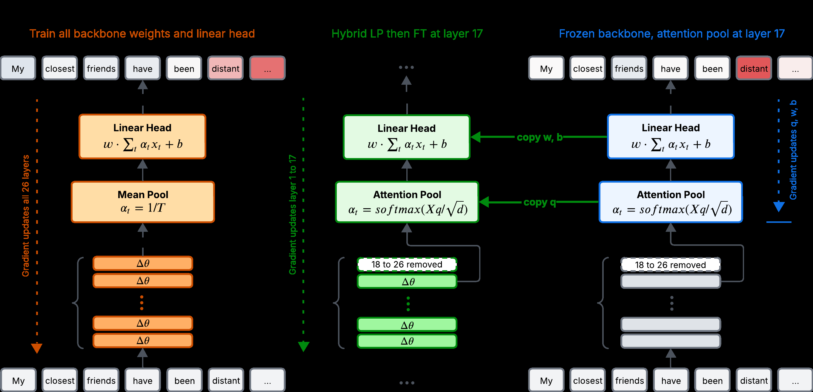
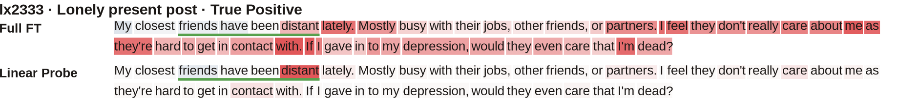

<h1 align="center">Does LLM Loneliness Detection Align with Expert Evidence?</h1>

<p align="center">
  <b>CLEAN-FT</b> · Concept-Localized Evidence-Aligned Fine-Tuning<br>
  Detect loneliness, check that the model's evidence is the experts' evidence, and check that the decision depends on it.
</p>

<p align="center">
  <a href="ML4H_2026.pdf"></a>
  <a href="ML4H_2026.pdf"></a>
  <a href="https://www.python.org/"></a>
  <a href="https://pytorch.org/"></a>
  <a href="https://github.com/astral-sh/uv"></a>
  <a href="LICENSE"></a>
  <a href="DATA_LICENSE.md"></a>
</p>

---

## Overview

Accurate loneliness detection does not guarantee that a model relies on evidence experts consider meaningful. This repository evaluates loneliness models along three dimensions and proposes a training strategy that keeps all three:

- **Detection.** Does the model predict loneliness correctly? (AUROC)
- **Plausibility.** Do the words the model attributes its decision to align with expert-annotated spans? (word-level AUPRC)
- **Faithfulness.** Does removing those words actually change the prediction? (ΔAOPC over a random ranking)

<p align="center">
  
</p>

Stages 1 and 2 use [LonXplain](https://doi.org/10.1007/978-3-031-35320-8_27) (3,522 Reddit posts with loneliness labels and expert evidence spans). Stage 3 transfers the trained detectors, without retraining, to voice conversations between older adults and a wellbeing chatbot, annotated by two experts. Backbones are Gemma-2-2B (primary) and Llama-3.1-8B (control).

**CLEAN-FT** (Concept-Localized Evidence-Aligned Fine-Tuning) first locates loneliness with an attention-pooled linear probe at an intermediate layer of the frozen model, then fine-tunes only the layers beneath that probe, so the decision stays where the concept is already represented.

<p align="center">
  
</p>

| Family | Method | Read-out | Head | What is trained |
|---|---|---|---|---|
| Fine-tune | **Full FT** | final layer | random | every backbone weight and the head |
| Fine-tune | **ML-FT** | layer 17 / 24 | random | the layers below the read-out and the head |
| Hybrid | **LP-FT** | final layer | probe-initialized | every backbone weight, starting from a solved probe |
| Hybrid | **CLEAN-FT** (ours) | layer 17 / 24 | probe-initialized | the layers below the read-out, starting from the probe |
| Probe | **Linear**, **MLP**, **SAE** | layer 17 / 24 | — | the probe only; the backbone is frozen |
| Reference | **Span-FT**, MentalBERT, GloVe+BiGRU | | | span-supervised upper reference and non-LLM baselines |

Every method is evaluated under mean pooling and attention pooling. The read-out layer is fixed a priori (layer 17 of 26 for Gemma, 24 of 32 for Llama) and never tuned on labels.

## Key findings

<p align="center">
  
</p>

**Same prediction, different evidence.** On a LonXplain true positive both the fully fine-tuned model and the frozen probe predict loneliness, but the probe concentrates its attribution on the expert-annotated span while full fine-tuning spreads it across the post.

### Table 1 · Detection and alignment on LonXplain

AUROC on the shared test set (1,761 posts) under mean and attention pooling, with Δ their paired difference. AUPRC (against the expert spans, 499 posts) and ΔAOPC for the attention-pooled model of each row, except SAE, MentalBERT and GloVe+BiGRU (mean pooling). ± are 95% bootstrap half-widths. † Integrated Gradients for the MLP.

| Type | Method | AUROC mean | AUROC attn | Δ | AUPRC DLA | AUPRC occlusion | ΔAOPC DLA |
|---|---|---|---|---|---|---|---|
| **Gemma-2-2B** | | | | | | | |
| Fine-tune | Full FT | 0.927 ±.012 | 0.931 ±.012 | +0.004 | 0.334 ±.026 | 0.495 ±.029 | 0.851 ±.151 |
| | ML-FT | 0.926 ±.012 | 0.931 ±.012 | +0.005 | 0.398 ±.027 | 0.519 ±.028 | 1.012 ±.148 |
| Hybrid | LP-FT | 0.895 ±.015 | 0.929 ±.012 | +0.035 | 0.375 ±.025 | 0.463 ±.032 | 1.198 ±.247 |
| | **CLEAN-FT** | 0.887 ±.015 | **0.933 ±.011** | +0.046 | 0.491 ±.025 | 0.553 ±.033 | 1.398 ±.144 |
| Probe | Linear | 0.837 ±.019 | 0.930 ±.012 | +0.092 | **0.504 ±.027** | **0.588 ±.032** | 1.672 ±.182 |
| | MLP | 0.872 ±.016 | 0.924 ±.012 | +0.052 | 0.493 ±.027 † | 0.576 ±.032 | **2.177 ±.475** † |
| | SAE | 0.870 ±.016 | – | – | 0.434 ±.029 | 0.402 ±.028 | 0.729 ±.165 |
| **Llama-3.1-8B** | | | | | | | |
| Fine-tune | Full FT | 0.918 ±.013 | 0.920 ±.013 | +0.002 | 0.236 ±.023 | 0.455 ±.030 | 0.601 ±.093 |
| | ML-FT | 0.911 ±.013 | 0.914 ±.013 | +0.002 | 0.161 ±.019 | 0.464 ±.031 | 0.325 ±.105 |
| Hybrid | LP-FT | 0.877 ±.016 | 0.930 ±.012 | +0.052 | 0.446 ±.027 | 0.488 ±.033 | 1.255 ±.193 |
| | **CLEAN-FT** | 0.865 ±.016 | **0.931 ±.012** | +0.066 | 0.383 ±.026 | 0.472 ±.030 | 0.949 ±.130 |
| Probe | Linear | 0.835 ±.018 | 0.905 ±.014 | +0.070 | 0.420 ±.027 | 0.440 ±.029 | 1.356 ±.166 |
| | MLP | 0.868 ±.017 | 0.885 ±.015 | +0.017 | **0.475 ±.028** † | 0.445 ±.029 | **1.623 ±.277** † |
| | SAE | 0.898 ±.015 | – | – | 0.410 ±.028 | 0.405 ±.028 | 1.307 ±.146 |
| **Reference** | | | | | | | |
| | Span-FT (Gemma) | 0.910 ±.014 | 0.924 ±.013 | +0.014 | 0.618 ±.026 | 0.458 ±.032 | 1.284 ±.220 |
| | Span-FT (Llama) | 0.892 ±.015 | 0.911 ±.013 | +0.020 | 0.615 ±.027 | 0.442 ±.030 | 1.663 ±.190 |
| | MentalBERT | 0.918 ±.013 | – | – | 0.183 ±.019 | 0.537 ±.030 | 0.478 ±.062 |
| | GloVe+BiGRU | 0.844 ±.018 | – | – | 0.107 ±.015 | 0.407 ±.030 | 0.351 ±.127 |
| Floor | Random ranking | 0.5 | 0.5 | – | 0.083 ±.010 | 0.083 ±.010 | 0.0 |

- **RQ1 · Detection.** Under attention pooling CLEAN-FT is the strongest detector on both backbones, and the frozen linear probe matches full fine-tuning on Gemma and trails it by 0.015 on Llama. Attention pooling adds 0.07 to 0.09 AUROC to the linear probe but almost nothing to full fine-tuning.
- **RQ2 · Evidence.** Fine-tuning from a randomly initialized head gives the least expert-aligned evidence (Full FT on Gemma, ML-FT on Llama); the frozen probes are the most aligned, and CLEAN-FT sits between them. Initializing the head from a probe (CLEAN-FT vs ML-FT) raises DLA alignment from 0.398 to 0.491 on Gemma and from 0.161 to 0.383 on Llama, and raises faithfulness in step. Under occlusion Full FT still depends on the expert words; after fine-tuning its own decomposition no longer points to them.

### Table 2 · Expert alignment in and out of distribution

All methods attention-pooled, transferred to the older-adult conversations without retraining. The two experts had 64.7% label agreement and a word-level Jaccard of 0.330, so they are reported separately.

| Method | LonXplain AUPRC | LonXplain ΔAOPC | Expert 1 AUPRC | Expert 1 ΔAOPC | Expert 2 AUPRC | Expert 2 ΔAOPC |
|---|---|---|---|---|---|---|
| **Gemma-2-2B** | | | | | | |
| Full FT | 0.334 | 0.851 | 0.346 | 0.772 | 0.260 | 0.865 |
| ML-FT | 0.398 | 1.012 | 0.350 | 1.256 | 0.262 | 1.354 |
| LP-FT | 0.375 | 1.198 | 0.394 | 1.971 | 0.301 | 1.520 |
| **CLEAN-FT** | 0.491 | 1.398 | **0.409** | **2.844** | **0.331** | **1.974** |
| Linear | **0.504** | 1.672 | 0.368 | 1.784 | 0.284 | 1.528 |
| MLP | 0.493 | **2.177** | 0.347 | 1.796 | 0.267 | 1.601 |
| **Llama-3.1-8B** | | | | | | |
| Full FT | 0.236 | 0.601 | 0.300 | 0.487 | 0.172 | 0.484 |
| ML-FT | 0.161 | 0.325 | 0.298 | 0.475 | 0.157 | 0.572 |
| LP-FT | 0.446 | 1.255 | 0.382 | 1.401 | 0.280 | 1.248 |
| **CLEAN-FT** | 0.383 | 0.949 | 0.373 | 1.249 | **0.297** | 1.292 |
| Linear | 0.420 | 1.356 | **0.387** | 1.525 | **0.297** | 1.607 |
| MLP | **0.475** | **1.623** | 0.360 | **1.886** | 0.287 | **1.960** |

- **RQ3 · OOD transfer.** Fine-tuning from a random head is the least faithful method on both backbones under distribution shift. On Gemma, CLEAN-FT is the most aligned and most faithful method for both experts, above the frozen probes; on Llama it stays close to the linear probe on alignment, consistent with the a priori read-out depth suiting Gemma better.

<details>
<summary><b>Table 3 · Mean-pooled evidence alignment on LonXplain</b> (appendix)</summary>

| Type | Method | Gemma AUPRC | Gemma ΔAOPC | Llama AUPRC | Llama ΔAOPC |
|---|---|---|---|---|---|
| Fine-tune | Full FT | 0.307 | 0.846 | 0.227 | 0.741 |
| | ML-FT | 0.392 | 0.945 | 0.153 | 0.270 |
| Hybrid | LP-FT | 0.434 | 0.869 | 0.395 | 1.258 |
| | **CLEAN-FT** | 0.459 | **1.609** | 0.415 | **1.472** |
| Probe | Linear | 0.416 | 1.372 | 0.404 | 1.168 |
| | MLP | **0.461** † | 0.788 † | **0.433** † | 0.471 † |
| | SAE | 0.434 | 0.729 | 0.410 | 1.307 |

The ordering is the same as under attention pooling, so the gap comes from the training method rather than the pooling strategy.
</details>

Every number above is in `results/` (`detection.csv`, `dla_auprc.csv`, `word_deletion.csv`, `ood_transfer.csv`, with bootstrap intervals), and `src/stage2/results_table.py` and `appendix_tables.py` render the LaTeX tables from them.

## Data

- **LonXplain** (Garg et al., 2023) is not redistributed; request it from its authors and place it at `data/lonxplain/raw/Lonesomenessdataset.csv`.
- **Expert-annotated older-adult conversations.** The full corpus (16 participants, 383 sessions) is private. We release the 34 screened phases that two experts annotated independently, de-identified, as the filled-in annotation sheets and one table: `data/conversation/annotations/` (`expert1.docx`, `expert2.docx`, `annotations.csv`, `annotator_agreement.csv`). The annotation rubric is Appendix C of the paper and the screening prompt is in `configs/prompts.yaml`.

See [data/README.md](data/README.md) for the columns and [DATA_LICENSE.md](DATA_LICENSE.md) for the terms.

## Installation

Requires Python 3.11, [uv](https://github.com/astral-sh/uv), and one GPU for the fine-tuning arms (an 80 GB card for Llama-3.1-8B with 8-bit AdamW; the probes, the metrics and the tables run on the CPU).

```bash
git clone <this repository> CLEAN-FT && cd CLEAN-FT
uv sync
uv run python -m spacy download en_core_web_sm        # sentencizer for the data preparation
cp .env.example .env                                    # only for the Claude API steps of Stage 3
```

Models are downloaded from the Hugging Face Hub on first use (`google/gemma-2-2b-it`, `meta-llama/Llama-3.1-8B-Instruct`, `mental/mental-bert-base-uncased`, Gemma Scope and Llama Scope SAEs through `sae-lens`); accept their licenses on the Hub first. Any command that loads a study model takes `--allow-model-process`; pin a GPU with `CUDA_VISIBLE_DEVICES=N` or `--devices N`.

## Quickstart

Method names in the code map to the paper as follows (`--model gemma2` or `llama`):

| Paper | Mean pooling | Attention pooling |
|---|---|---|
| Full FT | `full_ft` | `attn_ft` |
| ML-FT | `midlayer_ft` | `midlayer_attn_ft` |
| LP-FT | `lp_ft` | `attn_lp_ft` |
| **CLEAN-FT** | `midlayer_lp_ft` | `midlayer_attn_lp_ft` |
| Linear probe | `linear_probe` | `attention_probe` |
| MLP probe | `mlp_probe` | `attention_mlp_probe` |
| SAE probe | `sae_probe` | – |
| Span-FT | `span_ft` | `attn_span_ft` |
| MentalBERT, GloVe+BiGRU | `mentalbert`, `glove_bigru` | – |

**Prepare LonXplain** (CPU, then one GPU pass per backbone to cache the activations the probes read):

```bash
uv run python -m src.utils.data_prep
uv run python -m src.utils.data_prep --encode --model gemma2 --allow-model-process
```

**Stage 1 · train and score detection:**

```bash
uv run python -m src.stage1.train --method linear_probe attention_probe mlp_probe attention_mlp_probe sae_probe --model gemma2
uv run python -m src.stage1.train --method full_ft attn_ft midlayer_ft midlayer_attn_ft lp_ft attn_lp_ft midlayer_lp_ft midlayer_attn_lp_ft \
    --model gemma2 --allow-model-process --keep-checkpoint
uv run python -m src.stage1.train --method span_ft attn_span_ft --model gemma2 --allow-model-process --keep-checkpoint
uv run python -m src.stage1.train --method mentalbert --allow-model-process
uv run python -m src.stage1.train --method glove_bigru
uv run python -m src.stage1.detection --model gemma2                    # -> results/detection.csv
```

**Stage 2 · plausibility and faithfulness of each model's own evidence:**

```bash
uv run python -m src.stage2.dla_auprc --model gemma2 --compute --allow-model-process     # DLA word AUPRC -> results/dla_auprc.csv
uv run python -m src.stage2.occlusion --method occl_attn_ft occl_midlayer_attn_lp_ft occl_attention_probe \
    --model gemma2 --allow-model-process                                                  # occlusion AUPRC
uv run python -m src.stage2.occlusion --collect                                           # -> attribution_agreement.csv
uv run python -m src.stage2.word_deletion --model gemma2 --compute --allow-model-process  # ΔAOPC -> results/word_deletion.csv
uv run python -m src.stage2.uncertainty                                                   # paired bootstraps, per-fold AUROC
uv run python -m src.stage2.results_table                                                 # Table 1 (LaTeX)
uv run python -m src.stage2.appendix_tables --print                                       # Table 3
```

Repeat with `--model llama`. Every stage is resumable, and `--folds 0` or `--limit N` runs a smoke test.

**Stage 3 · transfer to the expert-annotated conversations** (the raw corpus is private; with your own transcripts in `data/conversation/<deployment>.csv`):

```bash
uv run python -m src.stage3.prepare_conversations --allow-network     # merge turns, clean fillers (Claude API)
uv run python -m src.stage3.detect_loneliness --allow-network         # screen phases (Claude API), write the annotation script
uv run python -m src.stage3.clinician_docx --build                    # the fillable .docx the experts receive
uv run python -m src.stage3.annotator_labels --annotator data/conversation/annotations/expert1.docx \
    --annotator data/conversation/annotations/expert2.docx            # both sheets -> results/stage3/annotations.csv, agreement
uv run python -m src.stage3.ood_detection --model gemma2 --allow-model-process
uv run python -m src.stage3.ood_detection --collect                   # -> results/ood_transfer.csv (Table 2)
```

**Figure 1** redraws from the included cache on the CPU: `uv run python plot/plot_feature_distortion.py`.

## Repository layout

```
├── ML4H_2026.pdf                 the paper
├── src/
│   ├── probe/                    linear, MLP, attention-pooled and SAE probes on the frozen backbone
│   ├── baselines/                fine-tuning recipes (Full, ML, LP, CLEAN, Span, LoRA), MentalBERT, GloVe+BiGRU, prompting
│   ├── stage1/                   train.py, detection.py (AUROC); METRICS.md defines every column
│   ├── stage2/                   dla_auprc.py, occlusion.py, word_deletion.py, uncertainty.py, results_table.py; METRICS.md
│   ├── stage3/                   conversation cleaning, screening, annotation sheets, OOD transfer and scoring
│   └── utils/                    data preparation, activation cache, DLA decomposition, word deletion, SAE hooks
├── configs/                      default.yaml (pinned hyperparameters), prompts.yaml (every prompt, SHA-256-pinned)
├── data/                         README.md; conversation/annotations/ (released expert annotations)
├── results/                      the summary tables behind Tables 1 to 3 (CSV with bootstrap intervals)
├── figures/                      the paper's figures
└── plot/                         Figure 1 (per-word attribution) and the shared style
```

Large intermediate files (activation caches, checkpoints of 76 GB across the fine-tuning cells, per-post attributions) are not tracked; the pipeline regenerates them.

## Citation

```bibtex
@inproceedings{cleanft2026,
  title     = {Does LLM Loneliness Detection Align with Expert Evidence?},
  author    = {Anonymous},
  booktitle = {Machine Learning for Health (ML4H) 2026, Proceedings Track (under review)},
  year      = {2026}
}
```

## License and ethics

- **Code:** [MIT](LICENSE).
- **Annotations and result tables:** [CC BY-NC 4.0](DATA_LICENSE.md). LonXplain (Garg et al., 2023) is used under its authors' terms and is not redistributed.
- The conversation study was approved by the authors' Institutional Review Board and all participants gave informed consent. The released phases are de-identified. The models detect loneliness *expression* in text, not person-level loneliness or clinical need, and are intended for expert-assisted analysis rather than clinical use.
